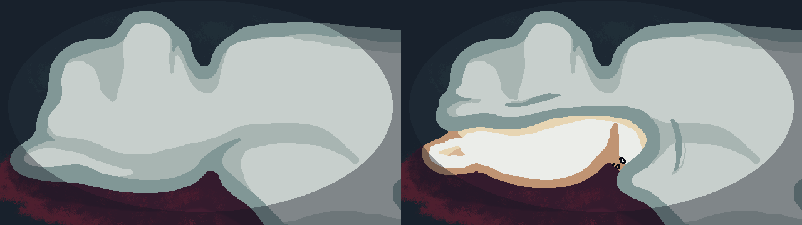

# 🎮 Gatotive


> **Jogo Sério (Serious Game) desenvolvido para o Projeto Integrador do curso de Jogos Digitais da UNISO.**


---

## 📌 Sobre o Projeto

Gatotive é um jogo com temática Noir, em pixel art, focado em conscientização ambiental relacionado a práticas de reprodução abusivas em animais. O projeto visa abordar exploração comercial, cruzamentos irresponsáveis e fraudes envolvendo animais de raça, utilizando mecânicas interativas para engajar e educar o jogador.

O jogador tem a visão de Kuro, o detetive da cidade, que precisa resolver o mistério de um provável falso assassinato, investigando alguns dos suspeitos e resolvendo enigmas.

### 🌟 Destaques
- **Tema Principal:** Educação Ambiental e Medicina Veterinária
- **Público-Alvo:** Jovens entre 17 e 25 anos, de áreas urbanas, que possuem gosto por temas investigativos e que trazem fortes críticas ao cuidado com animais, juntamente com a apreciação por jogos digitais mobile com assuntos sérios.
- **Plataforma:** PC (Windows) / WebGL / Mobile

---

## 🏫 Contexto Acadêmico & Parceiro Social

Este jogo foi concebido e desenvolvido no âmbito do **Projeto Integrador** do curso de **Jogos Digitais** na **UNISO - Universidade de Sorocaba** durante o segundo semestre de 2025.

### 🤝 Parceiro Real da Sociedade
O projeto conta com a colaboração e validação de **professores envolvidos no serviço da Clínica Veterinária Universitária e alunos do curso de veterinária, ambos da UNISO**. 
* **Atuação do Parceiro:** O parceiro auxiliou na definição das demandas comunitárias, fornecimento de dados reais e apoio no teste de impacto com os usuários finais.

---

## 🎯 Objetivos e Impacto Social

O objetivo central do jogo é gerar transformação e reflexão social através do engajamento lúdico.

* **Objetivo Geral:** Incentivar a denúncia dos casos de abusos de poder em animais domésticos, e da prática ilegal de reprodução animal baseada em maus tratos, compreendendo a importância de acionar um órgão de resgate.
* **Impacto Esperado:** 
  - Aumento da conscientização sobre o tema de reprodução abusiva em animais
  - Capacitação da comunidade para a prática de acionar órgãos de resgate aos animais
  - Apoio às atividades presenciais da Clínica Veterinária Universitária parceira

---

## 🕹️ Jogabilidade e Mecânicas Principais

| Screenshot | Descrição da Mecânica |
| :---: | :--- |
|  | **[Mecânica 1]:** Diálogos com os personagens do cenário. |
|  | **[Mecânica 2]:** Decisão de confiar ou duvidar das informações coletadas para cada personagem. |
|  | **[Mecânica 3]:** Inspecionar elementos da cena do crime. |
|  | **[Mecânica 4]:** Montar um quadro de investigação para colocar as informações coletadas em ordem. |

---

## 🛠️ Tecnologias Utilizadas

* **Game Engine:** [Unity 6.3 LTS](https://unity.com/)
* **Linguagem de Programação:** C#
* **Design & Arte:** Libresprite / Aseprite / Photoshop / IbisPaint
* **Áudio:** Audacity / Freesound
* **Gestão do Projeto:** GitHub / Milanote (Kanban) / Metodologia Ágil (Scrum)

---

## 🚀 Como Executar o Projeto

### Pré-requisitos
* **Unity Hub** instalado.
* Versão recomendada da Unity: `6.3 LTS`.

### Passos para Desenvolvimento (Unity Editor)

1. **Clone o repositório:**
   ```bash
   git clone https://github.com/BitSix-Studio/Gatotive.git
2. Abra o **Unity Hub**.
3. Clique em **Add / Adicionar** e selecione a pasta do projeto clonado.
4. Abra o projeto com a versão correta da Unity.
5. Acesse a pasta `Assets/Scenes/` e abra a cena `MenuInicial`

---

## 👥 Equipe e Orientação

### 👨‍🎓 Desenvolvedores
Tiago Rodrigues Chaves - Game Designer & Programador & UI & Sound Designer - GitHub | LinkedIn

Luana Cristini Araujo Franco - Game Designer & Artista Pixel Art & UI/UX & VFX & Roteirista - GitHub | LinkedIn

Murilo Pereira Lopes Silva - Animador 2D & Video Designer - GitHub | LinkedIn

Débora Maria Gurgel do Nascimento - Artista Pixel Art - GitHub | LinkedIn

Max Magalhães Mosso - Ilustrador Digital - GitHub | LinkedIn

### 👩‍🏫 Orientação Acadêmica
Prof. Ariel Emanuel Sebastian Campos - Orientador do Projeto Integrador

---
